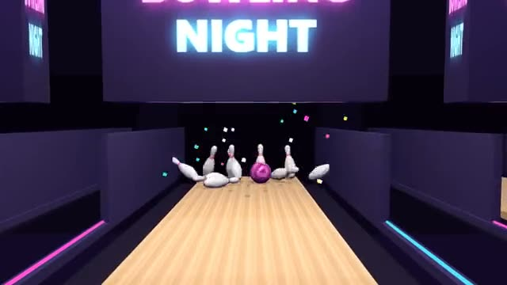

# Bowling Night

Curve it into the pocket. Everyone watches the pins fly. A multiplayer starter game from [Multiplayer Agent](https://multiplayeragent.com): 3D, turn-based, 2–6 players, with bots that fill empty seats.

## How it plays

Take turns bowling ten frames on one lane with real strikes, spares and a three-ball tenth. Line the ball up, swipe it down the lane and curve your swipe to hook it.

**Controls:** Drag sideways to line up, swipe up to roll, curve the swipe for spin (mouse or finger).

## Make it yours in the Game Builder

Open the [Game Builder](https://multiplayeragent.com), choose **Start from a starter game** and pick Bowling Night. It opens as version 1 in your studio, ready to play and publish. Then ask for changes, for example:

- Add bumpers in the gutters for beginners
- Make it cosmic bowling with glowing pins and a disco ball
- Add a bonus round where the pins are arranged in a line

## Run it yourself

1. Get a free publishable key (`pk_…`) at [multiplayeragent.com](https://multiplayeragent.com).
2. In `index.html`, put it in place of `pk_REPLACE_ME` in the `MP_CONNECT` block.
3. Serve the folder (for example `npx serve`) and open it. The 3D engine loads as a module, which browsers block from a file on disk.

Without a key it still runs, offline against bots.

## How it is built

- One `index.html` plus three.js in `libs/`. The comment at the top of the script maps the code and explains the multiplayer.
- The lane, the ball's hook, the pins and the swipe feel are all numbers in `CONFIG`. A roll is sent once, as its launch, and every player's browser replays it with the same physics, so everyone sees the same pins fall.
- **Leaderboard:** Each player's highest game, shown on the results card.
- **Host-run rules:** The host's browser checks each roll, counts the pins and keeps the score sheet; if it leaves, the next player takes over.
- **Bots:** Bots bowl in the empty seats, and take over for anyone who leaves.
- **Live sync:** Every roll plays out for everyone at once, pin for pin.
- `?attract` runs it offline with bots only. The preview video is recorded from it.

## License

MIT. three.js in `libs/` is MIT too (Copyright 2010-2024 three.js authors).
